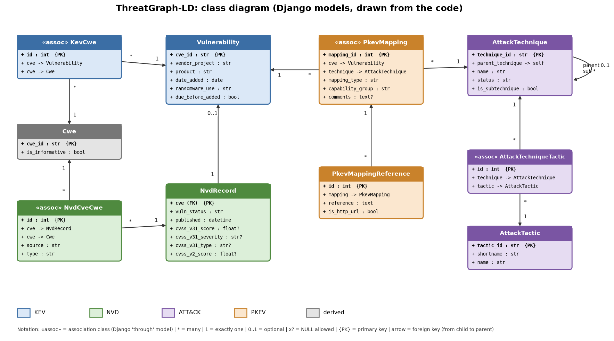
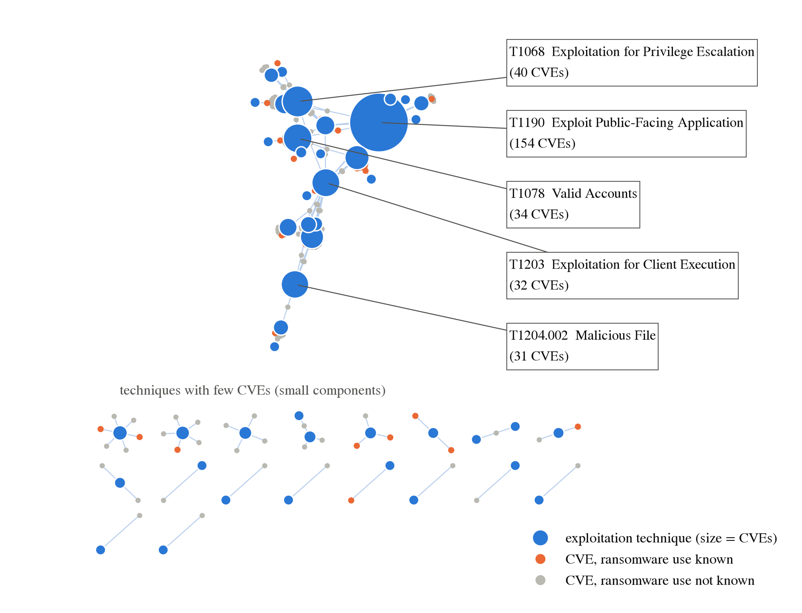

# ThreatGraph

**FAIR-oriented data management of exploited vulnerabilities.**

Course project for *Advanced Data Management* — MSc Data Science and Artificial Intelligence, University of Trieste (UniTS).

## Description

ThreatGraph integrates four open cyber-threat datasets into one documented, versioned and FAIR-oriented data system. The goal is to make every link between the sources **traceable, versioned and reusable**.

| Source | Content | Pinned version |
|---|---|---|
| **KEV** (CISA) | Vulnerabilities known to be exploited (scope of the project) | catalog 2025.07.28 (1,391 CVEs) |
| **NVD** (NIST, community mirror) | CVE description, CVSS, CWE | tag `v2025.07.28-000002` |
| **ATT&CK** (MITRE) | Attacker tactics and techniques | Enterprise 16.1 |
| **PKEV** (CTID Mappings Explorer) | Expert mapping CVE → ATT&CK technique | kev-07.28.2025 + attack-16.1 |

Main features:

- Reproducible download: sources pinned to a commit, SHA-256 checks, provenance manifest.
- Documented cleaning rules, with validation checks and negative tests.
- Relational model implemented with Django and SQLite.
- Read-only REST API (Django REST framework) with JSON and JSON-LD output (DCAT and PROV metadata).
- Hashed, read-only snapshots (`content_id` = SHA-256), inspired by the OAIS reference model.
- Interoperability example: merging ThreatGraph with two (simulated) third-party sources through SPARQL.

> **Note.** The SOC incident register and the patch tracker used in the interoperability example are **simulated**. The second snapshot (2026-10-26) is also simulated. The API serves the working database, not a selected snapshot.

## Structure

```
ThreatGraph/
├── config/sources.yaml     # pinned sources, expected hashes, licenses
├── data/
│   ├── raw/                # downloaded data (not versioned, only manifest and report)
│   ├── clean/              # 9 cleaned tables + manifest (only manifest and report versioned)
│   ├── snapshots/          # frozen database snapshots (AIP)
│   └── exports/            # JSON-LD exports and third-party example data
├── src/threatgraph/        # reusable code (download, cleaning, validation, JSON-LD, snapshots)
├── notebooks/              # executable steps, from download to results
├── webapp/                 # Django project: models, admin, REST API
└── docs/                   # design notes, validation reports, figures
```

Notebooks, in order: `01_download_data` → `02_clean_data` → `03_validate_clean_data` → `04_django_models_and_loading` → `05_api_and_client_tests` → `06_snapshot_and_diff` → `08_results_analysis` → `09_third_party_merge` (SPARQL).

## Quick start

```bash
conda env create -f environment.yml
conda activate threatgraph
# or: python -m venv .venv && pip install -r requirements.txt

# 1. Download and clean the data (run the notebooks 01, 02, 03)
jupyter lab

# 2. Build the database and start the API
cd webapp
python manage.py migrate
python manage.py load_clean_data
python manage.py runserver
```

API endpoints: `/api/vulnerabilities/`, `/api/techniques/`, `/api/tactics/`, `/api/cwes/`, `/api/dataset/`, `/api/context/`. Add `?format=jsonld` to get JSON-LD.

Create a snapshot: `python manage.py snapshot_db --label <label> --previous <path>`.

## Images


*UML schema of the database (generated from the Django models).*


*Mapping of the project onto the OAIS reference model.*


*Network of exploited vulnerabilities, techniques and tactics.*

## Data sources and licenses

The code is released under the MIT license (`LICENSE.txt`). **The data keep the license of their original source:**

| Source | License / terms |
|---|---|
| KEV | CC0-1.0 |
| NVD / CVE | NVD/CVE terms of use (public data, attribution) |
| ATT&CK | MITRE ATT&CK Terms of Use |
| PKEV | Apache-2.0 on the repository; data license not stated separately |

Source links:
- CISA KEV: https://github.com/cisagov/kev-data
- NVD mirror: https://github.com/fkie-cad/nvd-json-data-feeds
- MITRE ATT&CK: https://attack.mitre.org
- CTID Mappings Explorer: https://center-for-threat-informed-defense.github.io/mappings-explorer/

## References

- Wilkinson, M. D. et al. (2016). *The FAIR Guiding Principles for scientific data management and stewardship*. Scientific Data, 3, 160018.
- ISO 14721:2012. *Space data and information transfer systems — Open archival information system (OAIS) — Reference model*.
- W3C. *JSON-LD 1.1* (Recommendation, 2020).
- W3C. *Data Catalog Vocabulary (DCAT), Version 3* (Recommendation, 2024).
- W3C. *PROV-O: The PROV Ontology* (Recommendation, 2013).
- W3C. *SPARQL 1.1 Query Language* (Recommendation, 2013).
- Berners-Lee, T. *Linked Data* — 5-star open data scheme.
- Course slides, *Advanced Data Management*, University of Trieste, 2026.

## Author

Student project, University of Trieste (UniTS), academic year 2025/26.
